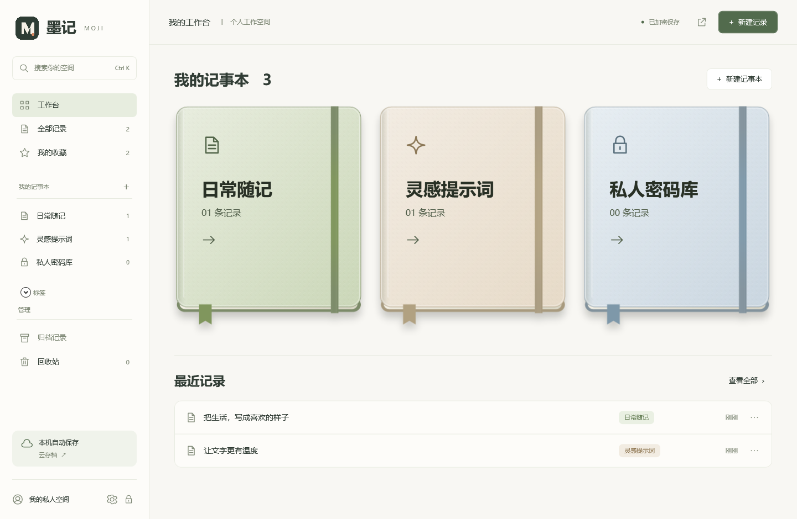
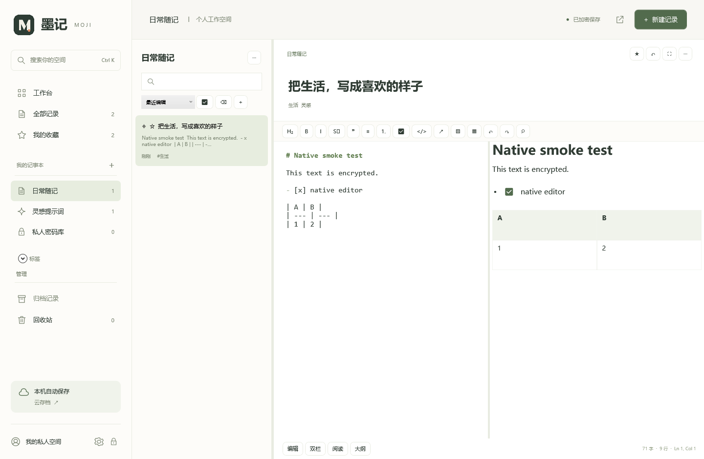
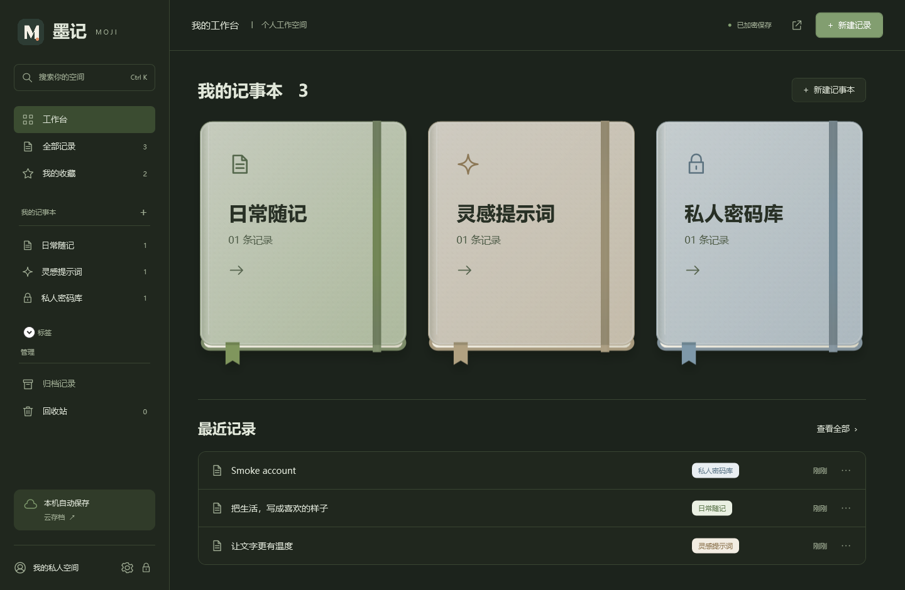
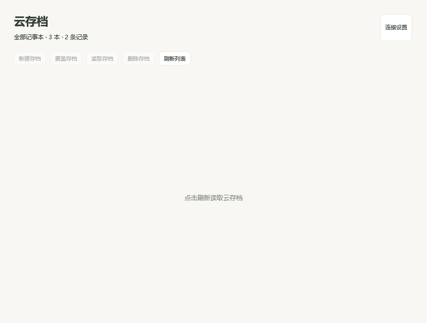
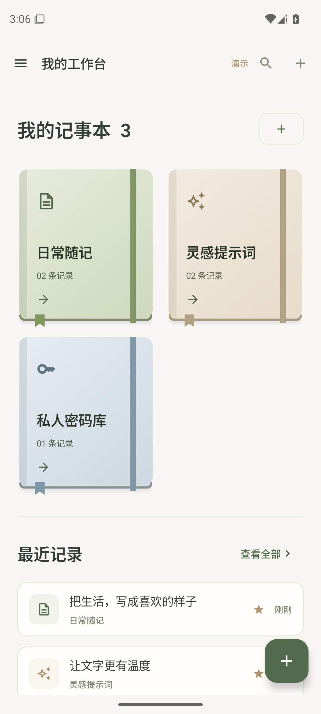
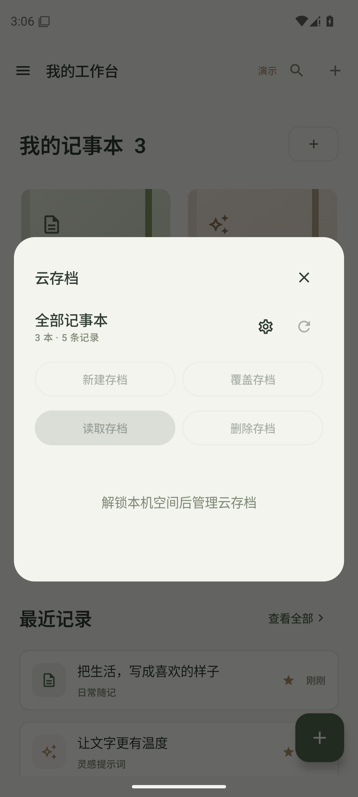
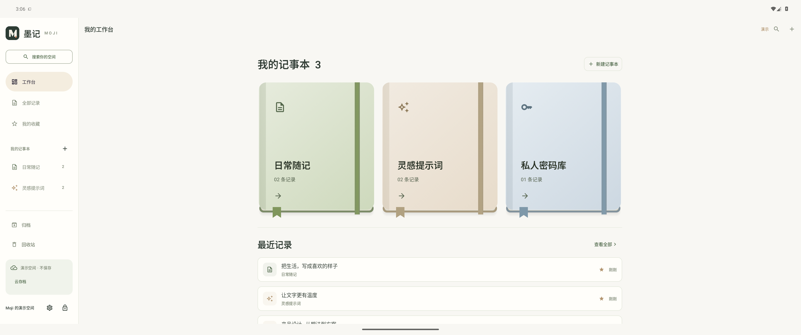
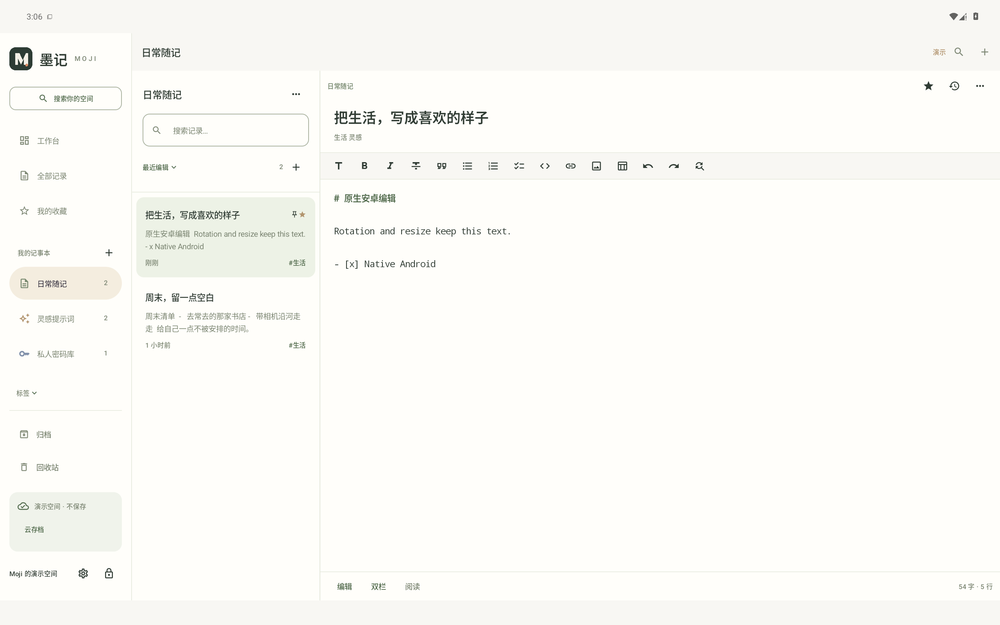

# 新版界面

保留参考图的暖白、鼠尾草绿与三种笔记本封面，删除首页标语、宣传插画和重复提示。所有界面均由原生控件绘制。

## Windows 工作台

## Windows 编辑器

## Windows 深色

截图来自实际 WPF 界面测试，展示示例数据。封面纹理、书脊、纸张、绑带和书签由原生绘图实现。

## 全局云存档

本机自动保存，四个操作管理整套项目数据。首次点击刷新读取云端列表，再选择新建、覆盖、读取或删除。

## Android

使用相同的三色笔记本风格。手机双列封面，平板与宽窗口采用列表/编辑分栏；首页最多三列并限制内容宽度。

### 手机

### 全局云存档

### 超宽窗口

### 平板编辑

截图由 API 35 Android 模拟器直接取得，展示演示数据。原生测试报告与其余旋转、窄窗口和密码模式截图保存在 [Android Actions](https://github.com/piayboy894/moji-notes/actions/runs/43670304701) 的 `Moji-Android-native-UI` 构建附件中。模拟器尺寸验证不代表三星 DeX 真机实测。

全局云存档提供新建、覆盖、读取、删除四个手动操作；本机编辑继续自动保存。正式安装包和验证范围见 [进度记录](PROGRESS.md)。
