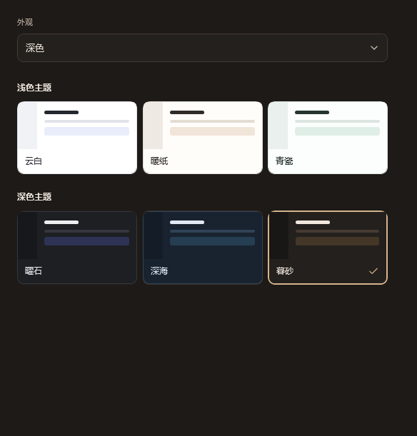

# 墨记主题与卡片操作设计

本次从反对者角度审查 2.2.0：大面积灰绿色把底层、侧栏、选择和变量填空染成一种颜色，语义与层次不清；编辑器独立黑灰、紫色混入原生界面，像两个产品拼接；深色浅绿按钮配白字只有约 2.97:1，浅色部分小字约 3.71:1，低于普通文本 4.5:1。单纯降低亮度不能解决这些问题。

采用中性或轻微带色的灰阶建立背景、侧栏、正文、浮层四级；强调色只表示操作、焦点和选择。正文是视觉重点，辅助文字降低强调但仍保持阅读对比度。按钮背景、按钮文字、选中背景及选中文字分别定义。笔记本自定义颜色作为内容身份保留，通用控件不继承笔记本色。

| 模式 | 名称 | 方向 | 背景 / 正文面板 | 强调色 |
| --- | --- | --- | --- | --- |
| 浅色 | 云白 | 中性、清晰，蓝色操作 | #F6F7F9 / #FFFFFF | #4058B6 |
| 浅色 | 暖纸 | 暖石灰、纸感，铜棕操作 | #F5F2EC / #FFFDFA | #885838 |
| 浅色 | 青瓷 | 清淡绿灰，克制青绿 | #F2F5F3 / #FCFEFD | #356B60 |
| 深色 | 曜石 | 中性石墨，柔和蓝紫 | #141518 / #1D1F23 | #A9B3FA |
| 深色 | 深海 | 深蓝灰，雾蓝操作 | #111820 / #19232F | #8ABCDD |
| 深色 | 暮砂 | 暖炭灰，低饱和沙金 | #1D1A18 / #24201D | #D6B58A |

浅深色各保存自己的选择；点击色卡即时切换，跟随系统时使用各自保存的样式。设置只显示模式、名称和简洁界面缩略图，不加入解释性文案。主题切换只更新颜色，不重建正文，不污染撤销与历史。

单一色表在 `assets/themes.json`，由 .NET、Compose 和内嵌编辑器共同使用。正文主文本对正文底色至少 7:1，辅助文本、按钮文字、变量空值提示与选择文字至少 4.5:1；必要控件边缘至少 3:1。细分隔线允许更低对比度，因为它不是唯一交互指示。文字与浮层颜色会在真实界面再检查，色卡通过不代表整屏自动合格。

记录卡片右下角依次为创建副本、置顶。图标小而可识别，保留足够点击区域、焦点与可访问名称。置顶允许多条，组内按所选排序；不改编辑时间、不切换当前正文、不改变记事本顺序。副本保留内容、变量和自定义属性，获得新 ID、空历史及不置顶状态；右键和卡片操作共用实现。

回收站导航支持不切换页面直接右键清空；回收站内空白处右键也能清空，空状态禁用，沿用一次永久删除确认。

插入正文的图片支持独立显示背景：白色、黑色、透明（正文底色）和透明网格。选中图片时显示四个色块按钮，不占用常驻工具栏；改变图片节点属性并进入撤销与保存，不改写原图片字节。显示背景随图片保存，两端一致。

## 调研来源及应用

- [Linear — How we redesigned the Linear UI (part II)](https://linear.app/now/how-we-redesigned-the-linear-ui)：借鉴中性、耐用的界面基底，以及将基础色、强调色、对比度作为系统设计的方式，不复制产品界面。
- [Linear — A calmer interface for a product in motion](https://linear.app/now/behind-the-latest-design-refresh)：借鉴减少不必要强调、统一组件状态与控制位置的实践。
- [Figma — Illuminating dark mode](https://www.figma.com/blog/illuminating-dark-mode/)：参考跨产品颜色体系和真实使用场景中的主题验证。
- [Superhuman Docs — New visual identity](https://blog.superhuman.com/docs-new-visual-identity/)：参考让写作面板突出、导航退后，以及避免品牌色泛滥的产品设计经验。
- [Radix — Understanding the scale](https://www.radix-ui.com/colors/docs/palette-composition/understanding-the-scale) 与 [Custom palettes](https://www.radix-ui.com/colors/docs/overview/custom-palettes)：参考背景、交互背景、边缘、实色与文本色阶的职责；六套配色是据此自行设计与核算。
- [Atlassian — Color palette](https://atlassian.design/foundations/color/color-palette/) 与 [Elevation](https://atlassian.design/foundations/elevation/)：参考浅深模式采用不同色阶映射，以及深色用更亮浮层表达前后关系。
- [Material — Color roles](https://m3.material.io/styles/color/the-color-system/)：将共享语义色映射至 Compose 各 Surface Container 与 on-color，避免默认组件残留另一套色调。
- [W3C — Understanding Contrast Minimum](https://www.w3.org/WAI/WCAG21/Understanding/contrast-minimum.html)：普通文字 4.5:1、较大文字 3:1 的阈值，作为可读性下限而不是审美结论。
